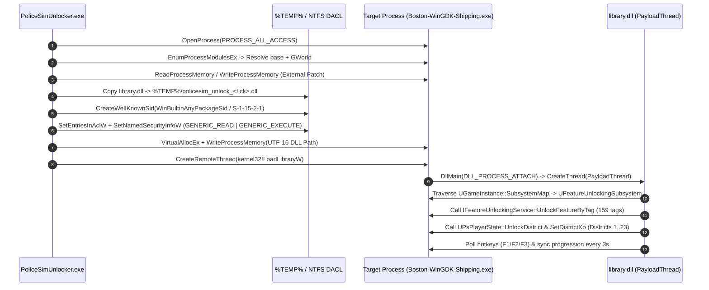
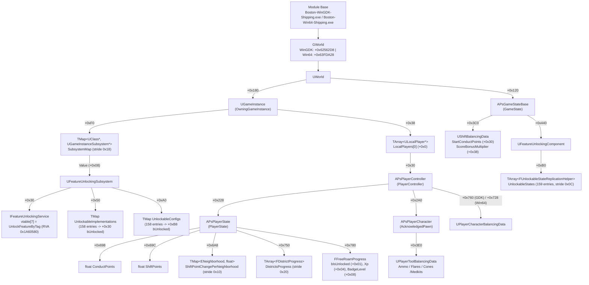

# policesimunlock

External progression patcher and UWP/WinGDK-compatible internal unlocker for **Police Simulator: Patrol Officers** (`Boston-WinGDK-Shipping.exe` and `Boston-Win64-Shipping.exe`).

Built on the AppContainer DACL injection approach from [uwp-injector](https://github.com/StackOverflowExcept1on/uwp-injector), `policesimunlock` patches `APsPlayerState`, `APsGameStateBase`, and `UFeatureUnlockingSubsystem` in memory while invoking native Unreal Engine 4 progression routines to unlock all districts, duty stars, tools, vehicles, and game modes without grinding shifts.

---

## Architecture

### 1. UWP / WinGDK Injection Pipeline

Microsoft Store / Xbox Game Pass builds (`Boston-WinGDK-Shipping.exe`) execute inside a restricted token / package context where `LoadLibraryW` fails with `ERROR_ACCESS_DENIED` unless the target binary explicitly grants `GENERIC_READ | GENERIC_EXECUTE` (`0xA0000000`) to `ALL APPLICATION PACKAGES` (`S-1-15-2-1` / `WinBuiltinAnyPackageSid`).

`PoliceSimUnlocker.exe` performs external pointer-chain patching first, then stages `library.dll` in `%TEMP%`, modifies its DACL, and injects it via `CreateRemoteThread`:



### 2. Unreal Engine 4 Object & Memory Hierarchy

Both the external patcher and internal payload resolve `UWorld` from `GWorld` (or dynamically via pointer-chain validation across the module's `.data` section if an update shifts the RVA) and traverse two primary branches:

1. **`UGameInstance` -> `SubsystemMap` & `LocalPlayers[0]`**
2. **`UWorld` -> `GameState` (`APsGameStateBase`) -> `FeatureUnlockingComponent`**



---

## Reversed Offsets & Structures

Between the Steam (`Boston-Win64-Shipping.exe`) and Xbox/WinGDK (`Boston-WinGDK-Shipping.exe` v22.3.3.0) builds, engine base classes (`UWorld`, `UGameInstance`, `AController`, `ACharacter`) and `APsPlayerState` offsets remain identical, while `GWorld` and two fields on `APsPlayerController` shift slightly.

### Module RVAs & Controller Offsets

| Symbol / Member | `Boston-WinGDK-Shipping.exe` | `Boston-Win64-Shipping.exe` | Notes |
| :--- | :--- | :--- | :--- |
| `GWorld` | `+0x62562D8` | `+0x63FDA28` | Fallback scanner probes `.data` if shifted |
| `FNamePool` (`GNames`) | `+0x60AD540` | — | UE4.27 chunked name pool |
| `IFeatureUnlockingService::UnlockFeatureByTag` | `+0x1A60580` | — | `void(__fastcall*)(uintptr_t, const FName*)` |
| `UPsPlayerState::UnlockDistrict` | `+0x1A604E0` | — | `void(__fastcall*)(uintptr_t, uint8_t, bool)` |
| `UPsPlayerState::SetDistrictXp` | `+0x1A5E180` | — | `void(__fastcall*)(uintptr_t, uint8_t, float, bool)` |
| `APsPlayerController::BalancingData` | `+0x0760` | `+0x0728` | `UPlayerCharacterBalancingData*` |
| `APsPlayerController::GameState` | `+0x07D8` | `+0x0790` | `APsGameStateBase*` (also at `UWorld + 0x120`) |

### Key Structures (`src/sdk.hpp`)

```cpp
// UFeatureUnlockingComponent + 0xB0 -> TArray<FUnlockableStateReplicationHelper> (stride 0x0C)
struct FUnlockableStateReplicationHelper {
    FName   UnlockableTag; // +0x00 (ComparisonIndex + Number)
    uint8_t bIsUnlocked;   // +0x08
    uint8_t Pad[3];        // +0x09
};

// APsPlayerState + 0x750 -> TArray<FDistrictProgress> (stride 0x20)
struct FDistrictProgress {
    uint8_t          District;              // +0x00 (EDistrict)
    uint8_t          bIsUnlocked;           // +0x01
    uint8_t          Pad02[2];              // +0x02
    float            Xp;                    // +0x04
    int32_t          DutyStars;             // +0x08
    uint8_t          Pad0C[4];              // +0x0C
    TArray<uint8_t>  UnlockedNeighborhoods; // +0x10 (TArray<ENeighborhood>)
};

// APsPlayerState + 0x780 -> FFreeRoamProgress (size 0x0C)
struct FFreeRoamProgress {
    uint8_t bIsEarlyFreeRoamUnlocked; // +0x00
    uint8_t bIsUnlocked;              // +0x01
    uint8_t Pad02[2];                 // +0x02
    float   Xp;                       // +0x04
    int32_t BadgeLevel;               // +0x08
};
```

---

## Building

Requires **CMake 3.20+** and **MSVC (Visual Studio 2022 Build Tools, x64)**. Both targets link the MSVC runtime statically (`/MT`) so `library.dll` has zero non-system DLL dependencies inside the UWP package container.

```powershell
cmake -B build -G "Visual Studio 17 2022" -A x64
cmake --build build --config Release
```

Compiled binaries are emitted to `build\Release\PoliceSimUnlocker.exe` and `build\Release\library.dll`.

---

## Usage

1. Launch **Police Simulator: Patrol Officers** and load into a shift or the precinct so `APsPlayerController` and `APsPlayerState` are instantiated.
2. Run `PoliceSimUnlocker.exe` from the directory containing `library.dll`:

```powershell
# Default: external patch + UWP DACL DLL injection (100,000 Shift Points, 1,000x XP multiplier, all unlocks)
.\PoliceSimUnlocker.exe

# Custom Shift Points, XP multiplier, plus movement speed/jump boost
.\PoliceSimUnlocker.exe --sp 500000 --mult 2500 --speed

# External memory patch only (skip DLL injection)
.\PoliceSimUnlocker.exe --no-inject
```

### Command-Line Flags

| Flag | Default | Description |
| :--- | :--- | :--- |
| `--sp <float>` | `100000` | Shift points written to `APsPlayerState` and every neighborhood entry |
| `--cp <float>` | `100` | Conduct points (`APsPlayerState::ConductPoints`) |
| `--mult <float>` | `1000` | Singleplayer XP score multiplier (`UShiftBalancingData::SingleplayerScoreBonusMultiplier`) |
| `--speed` | `off` | Patch `UCharacterMovementComponent` and `UPlayerCharacterBalancingData` walk/run speeds |
| `--no-inject` | `off` | Perform external `WriteProcessMemory` patching without injecting `library.dll` |
| `--dll <path>` | `.\library.dll` | Custom path to the payload DLL |

### In-Game Hotkeys (`library.dll`)

Once `library.dll` is attached (confirmed by a two-tone beep), a background thread keeps progression values synced every 3 seconds and listens for hotkeys:

- **`F1`** — Re-run native engine unlocks (`UnlockFeatureByTag`, `UnlockDistrict`, `SetDistrictXp`) + max progression stats
- **`F2`** — Re-apply stat & XP patches without calling native functions
- **`F3`** — Toggle super speed / multi-jump on `APsPlayerCharacter`

---

## Cheat Engine Tables

The `tables/` directory contains standalone Cheat Engine `.CT` tables for both builds:

- `tables/Boston-WinGDK-Shipping.CT` — Updated pointer chains for Xbox Game Pass / Microsoft Store (`+0x62562D8`)
- `tables/Boston-Win64-Shipping.CT` — Original pointer chains for Steam (`+0x63FDA28`)

---

## License

MIT License. See [LICENSE](LICENSE).
